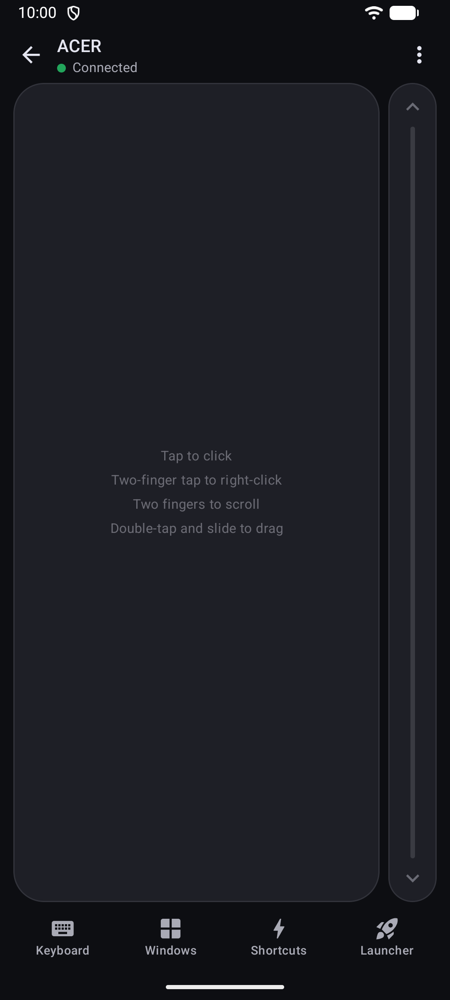
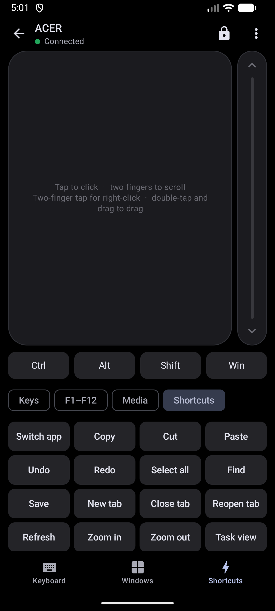
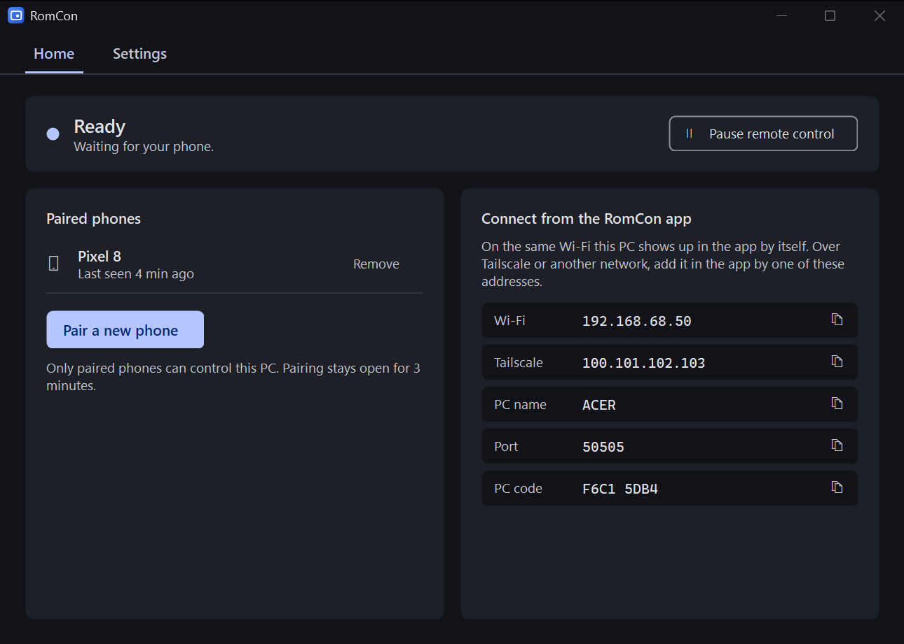

# RomCon

Use your Android phone as a wireless trackpad and keyboard for a Windows PC. It works over your Wi-Fi, or from anywhere over Tailscale.

RomCon is two small apps:

- **The Windows app** sits in the tray and turns what the phone sends into mouse and keyboard input. It's a single exe of about 180 KB with no installer. It runs on Windows 10 and 11 as they come.
- **The Android app** is the remote: a trackpad, your phone keyboard, and buttons for shortcuts and media keys. It needs Android 8.0 or newer.

  
  &nbsp;&nbsp;
  

<em>The phone app: the trackpad, and the shortcuts panel.</em>

  

<em>The Windows app.</em>

## What it does

- **Trackpad.** Move, tap to click, two-finger scroll, and double-tap and drag, like a laptop touchpad.
- **Keyboard.** The phone keyboard types straight into the PC, in any language, emoji included. There are Ctrl, Alt, Shift and Win keys, arrows, F-keys and common shortcuts.
- **Media and system.** Play/pause, volume, switch app, show desktop and lock the PC.
- **A bar you choose.** Put up to five buttons you use most under the trackpad.
- **Finds your PC.** A PC on the same Wi-Fi shows up by itself. Over Tailscale, add it by address.
- **Private.** A phone has to be paired with a PIN shown on the PC, and everything it sends is encrypted.

The [guide](docs/guide.md#features) lists every gesture, key and setting.

## Getting started

### 1. Get the two apps

**On the PC**, download [RomCon.exe](https://github.com/mikep49/romcon/releases/latest/download/RomCon.exe) and put it anywhere you like. There's nothing to install.

**On the phone**, add RomCon to [Obtainium](https://obtainium.imranr.dev/), which also keeps it up to date:

Or download [RomCon.apk](https://github.com/mikep49/romcon/releases/latest/download/RomCon.apk) and open it on the phone. Android asks you to allow installing from your browser or file manager the first time.

Every version is on the [releases page](https://github.com/mikep49/romcon/releases).

### 2. Pair your phone

1. **Run `RomCon.exe` on the PC.** The first time, it opens its window and starts pairing. When Windows Firewall asks, allow RomCon on **private** networks.
2. **Open the app on the phone.** On the same Wi-Fi, the PC appears under *On this Wi-Fi*. Otherwise tap **Add by address** and enter one of the addresses shown in the PC window.
3. **Pair.** Check that the *PC code* matches on both screens, then type the 6-digit PIN shown on the PC.

You pair once per phone. After that, tap the PC in the app to connect.

Closing the PC window leaves RomCon running in the tray. Turn on **Start with Windows** on its Settings tab to have it ready after every sign-in.

## Good to know

Windows itself blocks a few things:

- **Lock screen and UAC prompts.** You can lock the PC from the phone, but you unlock it at the PC.
- **Administrator windows**, such as Task Manager and installers. To control these, choose **Restart as administrator** in RomCon's tray menu.
- **Some games** read the hardware directly and ignore RomCon's input.

## More

- [Guide](docs/guide.md): all features, Tailscale, security, and notes for developers.
- [Protocol](docs/protocol.md): how the two apps talk to each other.
