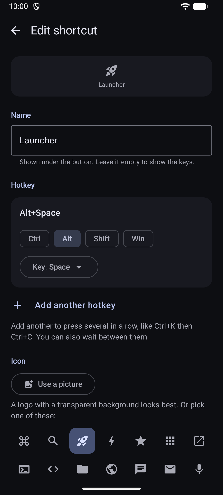

# RomCon guide

Everything the [README](../README.md) leaves out.

- [Features](#features)
- [Managing phones](#managing-phones)
- [Updates](#updates)
- [Tailscale](#tailscale)
- [Security](#security)
- [Limitations](#limitations)
- [Development](#development)

## Features

### Trackpad

- One finger moves the pointer, with adjustable speed and acceleration.
- Tap to left-click, two-finger tap to right-click, three-finger tap to middle-click.
- Two-finger scroll, vertical and horizontal, with momentum and a natural/traditional switch.
- Double-tap and drag to drag (selecting text, moving windows), like a laptop touchpad.
- A scroll bar down the right side of the pad: slide one finger along it to scroll.

### Bottom bar

- Keyboard, Windows key and Shortcuts sit under the pad by default.
- Choose your own buttons, up to five, and their order in Settings: Keys, Send text, Switch app, Task View, Show desktop, Esc, Enter, Copy, Paste, play/pause, volume, mute, and Left / Right / Middle click (hold one and move with another finger to drag).
- Make your own buttons under Settings, Bottom bar, Your shortcuts. Each one presses a hotkey you pick on the PC, such as Alt+Space to open Flow Launcher or Raycast. It can also press several hotkeys one after another, like Ctrl+K then Ctrl+C, with a wait of up to a minute between any two: F12, half a second, then F8, say. While a button waits, it stays lit; tap it again to stop it. The keys you can pick are Ctrl, Alt, Shift and Win with any letter, number, F1–F24, symbol, number-pad, arrow, editing or media key. A modifier key can also be pressed on its own.
- Give a button a name and an icon: one of the built-in icons, or a picture from your phone, such as the app's logo. A new button goes on the bar if there's room. Your buttons also appear at the start of the Shortcuts panel, so ones that don't fit on the bar are still a tap away.

<p align="center">
  
</p>
<p align="center"><em>A shortcut that opens a launcher with Alt+Space.</em></p>

### Keyboard

- The phone keyboard types straight into the PC. Autocorrect is off and Backspace always reaches the PC.
- A box above the phone keyboard shows what you type.
- The phone keyboard closes when you press its Enter key, so the trackpad is back in reach. To type several lines, turn that off under Settings, Keyboard. Enter on a hardware keyboard never closes it.
- Text is sent as Unicode, so accents, other scripts and emoji work whatever the PC's keyboard layout is.
- Ctrl, Alt, Shift and Win latches: tap one for the next key, long-press to lock it.
- Keys panel: Esc, Tab, arrows (hold to repeat), Home/End, PgUp/PgDn, Delete, F1–F12, media and volume keys.
- Shortcuts: copy, paste, undo, Alt+Tab (tap again to move through windows), Task View, Show desktop, Task Manager, close window, snip, and more.
- *Send text* types a whole block at once (links, passwords, pasted text).
- A hardware keyboard paired to the phone works too.

### Media controls on the lock screen

- While a paired PC is playing something (a YouTube video, Spotify, any player Windows knows about), the phone shows media controls on its lock screen and with its notifications: the title and artwork, play/pause, a seek bar, skip where the player offers it, and the PC's volume.
- They appear when playback starts and go away when it stops. A paused player keeps them for 10 minutes, so you can resume.
- While the PC is playing, the phone's volume buttons change the PC's volume. This can be turned off.
- You don't need to open the app. After pairing, the phone stays connected to the PC in the background, also after a restart. That connection can't control the pointer or keyboard, and it sends nothing while nothing changes, so the phone can sleep.
- Android requires a notification for an app that stays connected like this. It's silent and never on the lock screen. To hide it, long-press it and turn it off.
- The setting is under Settings, Media controls. Both apps need a version that has this; an older RomCon on the PC is left alone until you update it and connect to it once from the app.
- With several paired PCs, the phone stays with one at a time: the most recently used one it can reach.

### Connection

- PCs on the same Wi-Fi show up automatically.
- Over Tailscale (or any routed network), add the PC by its 100.x address or MagicDNS name.
- If the phone is on the PC's Wi-Fi it uses the faster LAN path, and it follows the PC when the router gives it a new address.
- Pointer movement and scrolling can go over UDP instead of TCP (Settings, Connection), which keeps the pointer smooth on weak Wi-Fi. Clicks, keys and text always use TCP. If UDP can't get through, the app carries on with TCP.
- Reconnects automatically. When the app goes to the background it stops controlling the PC, and the PC releases any held keys or buttons. Only the connection for the lock screen media controls stays.
- A *Lock PC* button, off by default (Settings, General). Windows only lets you unlock at the PC itself.
- *Pause remote control* on the PC, and a notification when a phone connects.

### Themes

Both apps offer System default, Light, Dark and OLED black. On the PC, the theme is on the **Settings** tab.

## Managing phones

- **Pair another phone**: click **Pair a new phone** in the PC window or the tray menu. Pairing stays open for 3 minutes.
- **Revoke a phone**: click **Remove** next to it under *Paired phones*.
- **Stop all control for a while**: click **Pause remote control** in the PC window. Phones also drop their media controls until you resume.

## Updates

Both apps look for a newer release on this repository's [releases page](https://github.com/mikep49/romcon/releases) and install it for you. Your settings and paired phones carry over.

- **On the PC**, RomCon checks a few seconds after it starts. When there's a new version, a notification says so. Click it, or open the **Settings** tab, and click **Update to …**. RomCon downloads the new `RomCon.exe`, puts it in place of the old one and restarts. **Check for updates** on the Settings tab checks again. If RomCon can't change the folder it's in (for example a folder under `C:\Program Files` while it runs without administrator rights), it offers to open the download page instead.
- **On the phone**, the app checks each time it opens. A new version shows a card on the home screen. Tap **Update**, or **Not now** to hide it until the app opens again. Settings, Updates, has the same and a **Check for updates** button. The app downloads the new APK and opens Android's installer on it. The first time, Android asks you to allow RomCon to install apps.
- [Obtainium](https://obtainium.imranr.dev/) works as well, if you'd rather it kept the phone app up to date.

## Tailscale

Install Tailscale on both devices and sign them in to the same tailnet. On the phone, add the PC by its Tailscale IP (`100.x.y.z`) or MagicDNS name. Nothing else is needed: Tailscale already encrypts the link, and RomCon adds its own TLS and pairing on top. Broadcast discovery doesn't cross Tailscale, which is why you add the PC by address.

If the phone can't reach the PC over Tailscale, check that Windows Firewall allows RomCon on the network profile Windows assigned to the Tailscale adapter.

## Security

- **Pairing is required.** A phone can only control the PC after you pair it with a PIN that's shown on the PC screen. The PIN works once and expires after 3 minutes. Pairing closes after 5 wrong attempts. Pairing is only open while you have it turned on.
- **Encrypted.** All TCP traffic is TLS 1.2, and pointer movement sent over UDP is AES-256-GCM with a key the PC issues over that TLS connection. The PC makes its own certificate on first run (stored DPAPI-encrypted in `%APPDATA%\RomCon`). The phone pins that certificate when pairing and refuses any other, so a device impersonating the PC never sees your keystrokes. The matching *PC code* on both screens guards the first pairing.
- **Administrator rights.** With *Always run as administrator* and *Start with Windows* both on, RomCon gets full rights at every sign-in without a prompt. Keep `RomCon.exe` in a folder only administrators can change, such as one under `C:\Program Files`, so another program can't swap it out first.
- **Revocable.** Each phone gets its own random token. The PC stores only a hash of it, and removing the phone on the PC revokes it at once. Tokens are kept in the app's private storage and excluded from Android backups.
- **Updates.** Both apps only ever ask GitHub about this repository's latest release, over HTTPS. A download whose SHA-256 doesn't match the one GitHub lists for that file is thrown away. Android also refuses an update that isn't signed with the same key as the installed app.

## Limitations

These are Windows rules, not bugs.

- **Lock screen, UAC prompts, Ctrl+Alt+Del**: Windows blocks injected input on the secure desktop. Lock the PC from the phone, but unlock it at the PC.
- **Admin windows** (Task Manager, installers, admin terminals): Windows ignores input from a normal app aimed at an elevated window. To control those, turn on **Always run as administrator** on the Settings tab, or use **Restart as administrator** in the tray menu or window for just this once. With it always on, Windows asks for permission when you open RomCon. When RomCon starts with Windows, a scheduled task named *RomCon* starts it as administrator without asking.
- Some games read raw hardware input and may ignore injected mouse or keyboard events.

## Development

### Building

- **Windows app**: run `windows\build.ps1`. It compiles `windows\bin\RomCon.exe` against the .NET Framework 4.8 that comes with Windows, so it needs only a C# compiler: Visual Studio or its Build Tools with the C# workload, or the .NET SDK.
- **Android app**: `cd android`, then `.\gradlew.bat assembleDebug`. It needs JDK 21 or newer (Android Studio's bundled one works) and the Android SDK. `assembleRelease` signs with the key described in `~/.romcon/keystore.properties` (`storeFile`, `storePassword`, `keyAlias`, `keyPassword`; `ROMCON_KEYSTORE_PROPERTIES` points elsewhere), or with the debug key if there's no such file.

### Releases

Tag a release `v<version>`, matching `versionName` in `android/app/build.gradle.kts` (raise `versionCode` too) and the assembly version in `windows/src/Program.cs`. Attach the two apps named exactly `RomCon.exe` and `RomCon.apk`: the README's download links, Obtainium and the apps' own updaters all look for those names on the latest release. Every APK must be signed with the same key, or Android won't install it over the previous one.

### Ports

| Port | Use |
| --- | --- |
| TCP 50505 | Control connection |
| UDP 50505 | Pointer movement, when the phone is set to UDP |
| UDP 50506 | Discovery |

The wire format is in [protocol.md](protocol.md).

### Command-line flags

`RomCon.exe` accepts:

| Flag | Effect |
| --- | --- |
| `--dry-run` | Log input and media commands instead of carrying them out. Also logs the pairing PIN. What's playing is still read, so the phone's media controls can be tried. |
| `--data-dir <dir>` | Use another settings folder instead of `%APPDATA%\RomCon`. |
| `--port <n>` | Listen on another port, TCP and UDP (the permanent setting is `port=` in `settings.ini`). |
| `--minimized` | Start in the tray (used by *Start with Windows*). |

### Testing against a real server

The Android unit tests include `LiveServerTest`, which pairs with and drives a real PC server through the app's own networking code. It's skipped unless you point it at one:

```powershell
RomCon.exe --dry-run --data-dir $env:TEMP\romcon-test --port 50599
# read the PIN from the RomCon window, then:
cd android
$env:ROMCON_TEST_HOST="127.0.0.1"; $env:ROMCON_TEST_PORT="50599"; $env:ROMCON_TEST_PIN="123456"
.\gradlew.bat testDebugUnitTest
```
